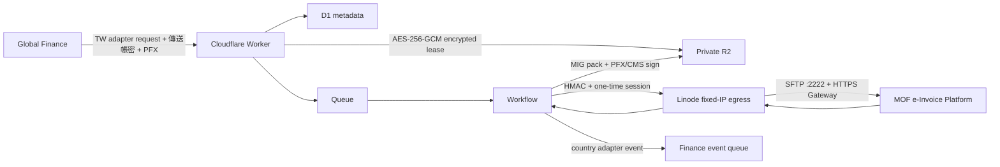

# Finance Taiwan e-Invoice Adapter

財政部電子發票 Turnkey 3.2.1／MIG 4.1 的 Cloudflare 重製版。它是全球 Finance 平台的台灣 country adapter，不是獨立 ERP，也不把台灣欄位滲入其他國家的財務模型。

## 結論

可重製，但不是「100% 只用 Cloudflare」：財政部 SFTP 與 Gateway 要求白名單來源 IP，因此保留一個極薄的 Linode egress agent。其餘接件、驗證、封裝、PFX 簽章、排程、狀態與檔案保存均在 Cloudflare。

> **離線整合必讀：** 若要把本專案交給無網路環境的 Claude Code，或由 Finance／Cloudflare／Linode 維運人員實際部署，請先閱讀 [Finance Taiwan e-Invoice Adapter：離線整合、部署與操作完整手冊](docs/offline-integration-guide.md)。該文件完整列出認證材料、18+4 種 MIG 協定、API/RPC contract、HMAC canonical string、D1/R2 layout、部署順序、UAT、錯誤處理與不可破壞的安全條件。KEY／CSR／CER／PFX 的申請與操作另有 [Turnkey 軟體憑證 PFX 離線工具完整操作手冊](docs/pfx-tool.md)，整合前必須一併閱讀。



重要認證邊界：

- 財政部「傳送帳號／傳送密碼」用於 SFTP 與 Gateway HTTP Basic + JSON login 欄位；原 Turnkey GUI 的 `ADMIN/ADMIN` 不使用。
- PFX／PKCS#12 與 PFX 密碼用於 attached PKCS#7/CMS 封套簽章。
- 傳送帳密不能取代憑證簽章；Worker 日常運行不需要硬體工商憑證，本專案只支援軟體 PFX。申請／登錄軟體憑證時，仍可能依 CA 與平台規定一次性使用工商憑證正卡、負責人自然人憑證或紙本審核。
- API 收到敏感資料後立即加密；Queue、Workflow params、D1 與 source manifest 都不保存明文。
- Linode 不保存帳密或 PFX。Worker 每次操作建立最長 5 分鐘、使用一次即銷毀的記憶體 session。
- Credential lease 到期後由 Cron 分批刪除 R2 密文，D1 僅保留已清除 object key 與時間的稽核紀錄。

## 專案組成

- `src/worker`: HTTP/RPC adapter、D1/R2、Queue、Workflow、Durable Object、PFX 簽章。
- `src/egress`: Linode Node.js 代理，負責固定 IP 的 SFTP／Gateway 連線、XSD 與回覆 CMS 驗證。
- `src/core`: Finance adapter 契約、MIG XML envelope、完整 inbound 檔名分類、ProcessResult／SummaryResult 解析。
- `schemas/xsd`: 原 Turnkey 3.2.1 所附 MIG 4.1 XSD。
- `migrations`: D1 schema。
- `deploy/egress`: Linode Docker/systemd/Caddy 範例。
- `tools/pfx`: Turnkey 3.2.1 行為相容的本機 TypeScript CLI；產生 PKCS#12 `.key`／CSR、以 CA CER 組成 PFX，並檢查 key/certificate match。
- `docs`: API、安全與相容性分析。

## 本機驗證

需求：Node.js 22、OpenSSL、`xmllint`（libxml2-utils）。

```bash
npm ci
npm run cf:types
npm run check
npm run build
npx wrangler d1 migrations apply TURNKEY_DB --local
```

目前自動驗證涵蓋契約、六種官方 inbound 檔名家族、envelope、逐張 ProcessResult 對應、SummaryResult、E0504 AES／ZIP、Gateway 3.1.3 程式規則、AES-GCM credential lease、一次性 egress session，以及「測試 PFX → attached CMS/SHA-256/RSA OID → OpenSSL 驗證 → 原 XML」往返。

### 產生軟體 PFX

本專案附帶 Turnkey 3.2.1 行為相容的離線 TypeScript CLI。它依原廠 `PFXBuilder`／`PFXKeyStore` 實作重製固定的 RSA-2048、PKCS#12 `.key`、`CN=<統編>`、`extensionRequest/keyUsage=Digital Signature` 與 SHA256withRSA CSR。`.key` 內含原廠流程所需的一年期暫時自簽憑證；它只用來把 private key 放入 PKCS#12 KeyStore，不能作為正式憑證。正式 PFX 一定要等 CA 核發 CER 後才能組成。

這是 repository 內的**本機離線維運工具**，不是 Worker endpoint；KEY、CSR 產生和 CER→PFX 組裝都不在 Cloudflare 執行，也不會把 private key 傳到 Worker、R2、D1、Queue、Workflow、Linode 或 CA。

```bash
npm run pfx -- request --ban 12345678
npm run pfx -- inspect-key --key ./12345678_20241231115134.key
npm run pfx -- assemble --key ./12345678_20241231115134.key --cer ./issued.cer --out ./signing.pfx
npm run pfx -- inspect --pfx ./signing.pfx
```

只上傳 `.csr`；`.key` 與同一組八碼密碼必須保存到 CER 核發並完成 PFX 組裝。完整申請順序、每個畫面要做什麼、檔案辨識、CA 邊界、備份、驗證、Finance API 對應與錯誤排查見 [docs/pfx-tool.md](docs/pfx-tool.md)。密碼只接受互動式 TTY 隱藏輸入，不可放入 command line、環境變數或 CI log。

### 協定範圍

- Finance 可送出的 MIG 4.1 訊息共 18 種：`A0101 A0102 A0201 A0202 A0301 A0302 B0101 B0102 B0201 B0202 E0401 E0402 F0401 F0501 F0701 G0401 G0501 G0701`。
- `E0501 E0502 E0503 E0504` 是平台下行資料，只能接收，不能當成 Finance submission 上傳。
- API 會強制官方傳輸矩陣：`A*/B*` 十種交換訊息只能是 `B2B + EXCHANGE`；`E0401/E0402` 只能是 `B2P + MESSAGE`；`F*/G*` 六種存證訊息只能是 `B2S + STORAGE`。只有 EXCHANGE 接受 `toPartyId`。
- 支援 SFTP `in`／`out`、Gateway `pfs001`～`pfs005`、attached Base64 CMS、ProcessResult、B2B Ack、每日 SummaryResult、E0501～E0503 與 E0504 加密 ZIP。
- B2B `EXCHANGE` 一個傳輸只能有一張文件；其他封包最多 1000 張且來源 XML 合計上限為 15,000,000 bytes，簽章後仍硬性限制 20 MiB。
- outbound 固定使用 Gateway 支援的 `zip: "0"`；E0504 下行 ZIP 仍完整解密與展開。Finance 若有更大批次，必須在 adapter contract 外先分批。

## 部署前

1. 建立 D1、R2、jobs queue、DLQ、Finance events queue，將實際 ID／名稱填入 `wrangler.jsonc`。
2. 設定三個 Worker secrets：

   ```bash
   wrangler secret put ADAPTER_API_KEY
   wrangler secret put EGRESS_HMAC_SECRET
   wrangler secret put CREDENTIAL_ENCRYPTION_KEY
   ```

   `CREDENTIAL_ENCRYPTION_KEY` 必須是 32 個隨機 bytes 的 Base64；可用 `openssl rand -base64 32` 產生。

3. 在 Linode 設定相同的 `EGRESS_HMAC_SECRET`，釘選財政部 SFTP host key，並以 TLS 網域公開 egress endpoint。財政部公開的 Turnkey 文件目前只列出 SFTP 主機、IP 與 Port，原始 Turnkey 套件也沒有附可直接信任的 `known_hosts` 或 SHA-256 fingerprint；`deploy/egress/accounts.example.json` 中的 `SHA256:REPLACE_WITH_PINNED_HOST_KEY` 因此只是 placeholder，不能直接部署使用，未換成有效 OpenSSH SHA-256 fingerprint 時 egress agent 會拒絕啟動。
4. 向財政部申請把 Linode IPv4 加入測試／正式環境白名單。
5. 先在財政部測試環境，以真實傳送帳密、已登錄 PFX 與官方測試案例完成 UAT，再切正式環境。

外部上線必備資料如下，缺一不可：

- 財政部測試／正式傳送帳號與傳送密碼；
- 可由該營業人使用、含私鑰且密碼正確的 PFX／PKCS#12；
- 測試／正式 Gateway 與 SFTP endpoint（預設值已列入範例設定）；
- 經財政部確認的 SFTP SHA-256 host-key fingerprint；
- 已加入財政部白名單的 Linode 固定 IPv4；
- 營業人 BAN、送方繞送代碼，以及交換對象的 BAN（收方繞送碼由 pfs002 查詢）。

### 財政部 SFTP host-key fingerprint

正式與測試環境必須分別取得並釘選：

- 正式：`sftp.einvoice.nat.gov.tw:2222`
- 測試：`tsftp.einvoice.nat.gov.tw:2222`

正確程序是先請財政部電子發票平台客服或 Turnkey 申請窗口，透過正式通知或工單提供／確認各環境的 SSH host-key algorithm 與 SHA-256 fingerprint。Linode IP 加入白名單後，可在 Linode 擷取伺服器提供的候選公鑰並計算 fingerprint：

```bash
ssh-keyscan -T 10 -p 2222 sftp.einvoice.nat.gov.tw > mof-prod.keys
ssh-keygen -E sha256 -lf mof-prod.keys

ssh-keyscan -T 10 -p 2222 tsftp.einvoice.nat.gov.tw > mof-test.keys
ssh-keygen -E sha256 -lf mof-test.keys
```

必須將掃描結果與財政部透過第二通道提供的 fingerprint 逐字核對後，才可填入 `deploy/egress/accounts.json` 的 `hostKeySha256`。不可只相信第一次 `ssh-keyscan` 的結果，因為未經核對的首次連線仍可能遭到中間人攻擊。若財政部無法提供 fingerprint，才可將多個獨立網路來源取得且完全相同的結果作為 TOFU（Trust On First Use）基準，並記錄取得時間、IP、key algorithm 與核對人；其安全保證低於財政部正式確認。

財政部若通知更換 SSH host key，應先取得並核對新 fingerprint，再更新設定與重新部署；不得在連線失敗時停用 `hostVerifier` 或改成接受任意 host key。

完整離線交接與實作手冊見 [docs/offline-integration-guide.md](docs/offline-integration-guide.md)，精簡 API 範例見 [docs/api.md](docs/api.md)，設計與風險邊界見 [docs/architecture.md](docs/architecture.md)，逆向相容性盤點見 [docs/turnkey-compatibility.md](docs/turnkey-compatibility.md)。

## 驗證狀態

程式已通過 TypeScript worker/egress 型別檢查、單元測試、官方 XSD byte-for-byte 比對、D1 本機 migration、Worker 本機 workerd 啟動、egress HMAC 啟動 smoke test，以及 Wrangler deploy dry-run。靜態協定面已完整，但尚未取得使用者的財政部測試帳號、PFX、白名單、官方 SFTP host-key fingerprint 與測試案例，因此不能宣稱已通過財政部端到端驗收或取得財政部認證。
