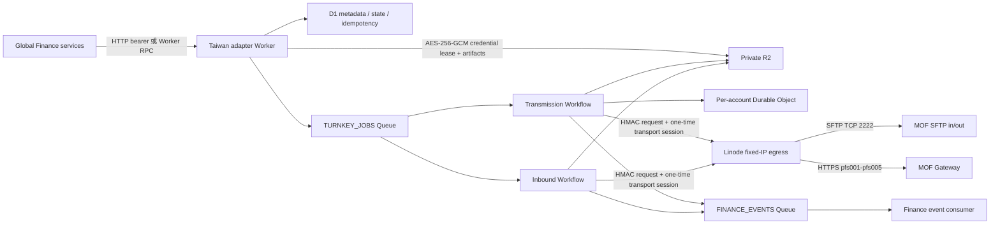
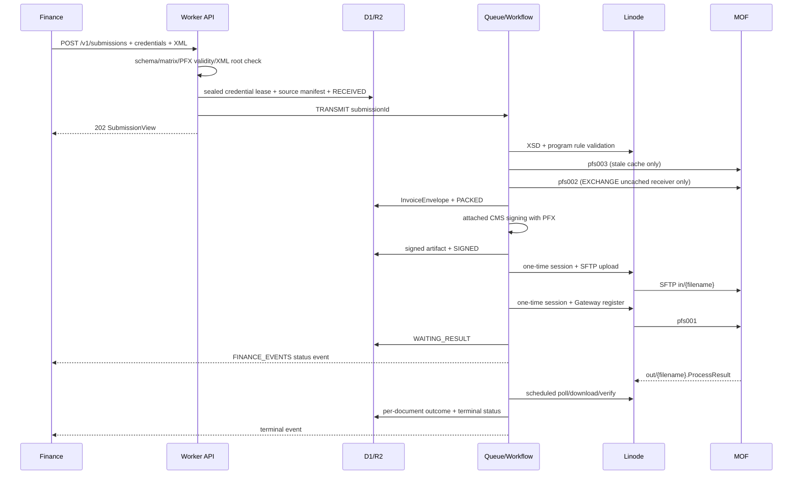

# Finance Taiwan e-Invoice Adapter：離線整合、部署與操作完整手冊

本文件是 `finance-tw-einvoice-adapter` 的離線交接手冊。目標讀者是負責全球 Finance 平台、Cloudflare 基礎設施、Linode 固定出口與台灣財政部電子發票串接的工程師，亦可直接交給沒有網路的 Claude Code 作為整合上下文。

文件描述的是此工作目錄中目前已實作的程式，不是概念提案。若本文件與程式碼發生衝突，以 `src/core/contracts.ts`、`src/worker`、`src/egress`、`migrations`、`wrangler.jsonc` 的實際內容為準。修改契約或協定後，必須同步更新本文件。

## 0. 先讀結論

- 這是全球 Finance 系統中的台灣 country adapter，只接受 `country: "TW"`，不應把台灣 MIG 欄位加入全球共用財務模型。
- Cloudflare Worker 負責外部服務 API、驗證、PFX 簽章、D1/R2、Queue、Workflow、Cron 與 Finance events。
- 財政部的 SFTP 與 Gateway 需要白名單來源 IP，因此仍需一台具有固定 IPv4 的薄型 Linode egress agent。它只處理網路出口、SFTP、Gateway、XSD、下行 CMS 驗證與 E0504 解密，不保存業務狀態。
- 本案不處理硬體工商憑證 runtime 或 PKCS#11。可使用財政部傳送帳號、傳送密碼、含 RSA 私鑰的軟體 PFX/PKCS#12，以及 PFX 密碼；軟體憑證申請／平台登錄階段仍可能依規定一次性使用正卡、自然人憑證或紙本審核。
- 傳送帳密不能取代 PFX：傳送帳密用於 SFTP 與 Gateway；PFX 用於財政部要求的 attached PKCS#7/CMS 簽章。原 Turnkey GUI 的 `ADMIN/ADMIN` 不屬於 serverless contract。
- 目前 `POST /v1/submissions` 每次都必須帶 `credentials`。獨立 credential lease API 用於延長收件輪詢與提供過期 submission 的 fallback，不是可替代 `credentials` 的 lease reference。
- 靜態協定、本機測試、XSD 與建置已驗證；尚未取得真實財政部測試帳號、已登錄 PFX、白名單與官方確認的 SFTP host-key fingerprint，因此不能宣稱已通過財政部 UAT 或取得認證。

## 1. 文件與程式碼閱讀順序

離線 Claude Code 第一次接手時，建議依下列順序讀取：

1. 本文件：完整理解服務邊界、部署順序、API 與不可變條件。
2. `../src/core/contracts.ts`：Finance 請求、狀態、事件與 Gateway payload 的型別真相來源。
3. `../src/worker/index.ts`：公開 HTTP/RPC 路由、Queue consumer 與 Cron。
4. `../src/worker/submissions.ts`：提交、PFX 預檢、idempotency、R2 manifest 與 credential lease。
5. `../src/worker/workflows.ts`：完整上行與下行生命週期。
6. `../src/worker/egress-client.ts` 與 `../src/egress/auth.ts`：Worker 到 Linode 的 HMAC 協定。
7. `../src/egress/server.ts`、`gateway.ts`、`sftp.ts`：Linode API、財政部 Gateway 與 SFTP 實作。
8. `../schemas/xsd`：MIG 4.1 結構的 canonical schema；不要依猜測自行發明 XML 欄位。
9. `../migrations` 與 `../wrangler.jsonc`：持久層與 Cloudflare bindings。
10. `../tools/pfx` 與 `pfx-tool.md`：離線產生 KEY／CSR、組成 PFX、檢查憑證及完整 CA／平台操作邊界。
11. `../test`：既有安全與相容性回歸測試。

其他摘要文件：

- `../README.md`：專案總覽與最短部署清單。
- `api.md`：精簡 API 範例。
- `architecture.md`：元件與安全邊界摘要。
- `turnkey-compatibility.md`：原 Turnkey 3.2.1 相容性結論。
- `pfx-tool.md`：KEY、CSR、CA CER、PFX、平台登錄與 Finance input 的逐步操作手冊。

## 2. 已驗證程度與證據邊界

### 2.1 已在本機確認

- TypeScript Worker 與 Node.js egress 均通過型別檢查與建置。
- 8 個測試檔、30 個測試涵蓋核心契約、檔名、Envelope、結果解析、Turnkey 3.2.1 KEY／CSR／PFX、PFX/CMS、E0504、credential vault、session 與業務規則。
- 18 個訊息 XSD、7 個 `common/v41` XSD、2 個 generic include，共 27 個 XSD，與 supplied Gateway 3.1.3 JAR 內資源逐 byte 相同，且可由 `xmllint` 編譯。
- PFX 往返測試已確認：測試 PFX可產生 attached CMS，digest 使用 SHA-256，SignerInfo 使用 `sha256WithRSAEncryption`，OpenSSL 能驗證並取回原 XML。
- D1 migration 可在本機套用；Worker 可由 workerd 啟動；Wrangler dry-run 可成功打包。
- egress 的 HMAC、timestamp、nonce replay、body hash 與一次性 session 已有測試。
- supplied Turnkey 3.2.1、Gateway 3.1.3、MIG 4.1 與目前本機財政部 Turnkey v4.0 手冊的關鍵傳輸流程已交叉比對。

### 2.2 仍需財政部測試環境確認

- 真實傳送帳密能否同時登入測試 SFTP 與 Gateway。
- PFX 是否已由該營業人登錄、憑證鏈與實際金鑰是否被平台接受。
- Linode IPv4 是否已加入測試與正式環境白名單。
- 財政部正式提供或確認的 SFTP host-key algorithm 與 SHA-256 fingerprint。
- 每一種 Finance 實際會使用的訊息，至少一筆接受案例與一筆拒絕案例。
- ProcessResult、Ack、SummaryResult 與 E0504 在該測試帳號下的實際檔名與 payload。
- 「SFTP 成功，但 pfs001 response 遺失」時的重送行為。
- 生產 PFX 尺寸、批次大小、Worker CPU 與 $5 Linode 容量。
- `G0701`：手冊、Gateway XSD 與模型均存在，但 supplied desktop `MessageFormatFactory` 未列入其目錄清單，必須單獨做財政部 UAT。

因此，「協定實作完整」在本專案中代表靜態與本機可驗證的 surface 已覆蓋；不等同財政部外部認證完成。

## 3. 認證材料與責任分工

| 材料 | 用途 | 會到哪裡 | 是否持久化 |
|---|---|---|---|
| `ADAPTER_API_KEY` | Finance 呼叫 Worker 的 service bearer | Finance、Worker | Cloudflare secret |
| 財政部傳送帳號 `loginId` | SFTP username、Gateway Basic 與 JSON body | Worker 短暫解密、Linode memory、財政部 | R2 中以 AES-256-GCM 密封；Linode 不落地 |
| 財政部傳送密碼 `loginPassword` | SFTP password、Gateway Basic 與 JSON body | 同上 | 同上 |
| PFX/PKCS#12 bytes | InvoiceEnvelope attached CMS 簽章 | Finance、Worker | R2 中以 AES-256-GCM 密封；不送 Linode |
| PFX 密碼 | 開啟 PKCS#12 | Finance、Worker | 與 PFX 一起密封；不送 Linode |
| `CREDENTIAL_ENCRYPTION_KEY` | 加密 credential lease | Worker | Cloudflare secret；必須是 32 random bytes 的標準 Base64 |
| `EGRESS_HMAC_SECRET` | Worker ↔ Linode request authentication | Worker、Linode | Cloudflare secret + Linode root-readable env |
| SFTP host-key fingerprint | 驗證財政部 SFTP server identity | Linode | `accounts.json`，非秘密但必須可信 |

### 3.1 PFX 的實際限制

- 輸入格式固定為 `format: "PFX"`。
- `pfxBase64` 必須是標準 Base64，不能含換行，最長 4,000,000 字元。
- PFX 內必須含 RSA private key，以及 public key 與該 private key 相符的 certificate。
- 憑證的 `notBefore <= now < notAfter`；過期或尚未生效會在 API 接件時拒絕。
- PFX 密碼可以是空字串，但只有 PFX 本身確實無密碼時才有效。
- 前項是 Worker 對既有 PKCS#12 的技術相容性；本專案附帶的本機工具以 Turnkey 3.2.1 為相容目標，固定產生 RSA-2048、PKCS#12 `.key`、只有 `CN=<統編>` 且要求 Digital Signature 的 CSR，並強制使用恰好 8 碼 ASCII 英數密碼。完整流程見 [`pfx-tool.md`](pfx-tool.md)。
- KEY／CSR 產生與 CER→PFX 組裝是受控本機維運工作，不是 Worker endpoint，也不使用 D1、R2、Queue 或 Workflow。只有 CA 核發後的正式 PFX 會依本架構由 Finance 傳入 Worker。
- 目前不支援 EC private key、硬體卡、PKCS#11、遠端 HSM 或工商憑證讀卡機。

### 3.2 PFX 不是帳密的替代品

一個成功的傳輸同時需要：

1. 傳送帳密：登入 SFTP，並呼叫 pfs001/pfs002/pfs003/pfs004/pfs005。
2. PFX 與 PFX 密碼：由 Worker 將 InvoiceEnvelope 產生 attached CMS。
3. 白名單 Linode IPv4：讓 SFTP/Gateway 看到允許的來源位址。
4. 已核對的 SFTP host key：避免將帳密送給偽造的 SSH server。

## 4. 系統架構



### 4.1 Cloudflare 各元件責任

| 元件 | binding/name | 責任 |
|---|---|---|
| Worker HTTP handler | `finance-tw-einvoice-adapter` | 對外 API、bearer auth、帳戶與提交管理、artifact 下載 |
| Named RPC entrypoint | `TaiwanEinvoiceAdapter` | 提供同 Cloudflare 帳戶內的 `submit()`、`status()` |
| D1 | `TURNKEY_DB` | account、submission、document outcome、status event、inbound、routing cache、pfs003 cache、credential purge audit |
| R2 | `TURNKEY_FILES` | source manifest、密封 credential lease、Envelope、signed CMS、下行原檔與解析後檔案 |
| Jobs Queue | `TURNKEY_JOBS` | 傳送與輪詢工作，at-least-once |
| Jobs DLQ | `finance-tw-einvoice-jobs-dlq` | 超過 Queue retry 的工作 |
| Finance Queue | `FINANCE_EVENTS` | 對全球 Finance 發布標準化 country adapter events |
| Workflow | `TRANSMISSION_WORKFLOW` | 上行 durable steps 與 retry |
| Workflow | `INBOUND_WORKFLOW` | SFTP out 輪詢、驗證、對帳、轉送與刪除 |
| Durable Object | `TRANSMISSION_COORDINATOR` | 每個 account 的 filename reservation 與傳輸 stage 協調 |
| Cron | `*/5 * * * *` | 每 5 分鐘為有有效 lease 的 active account 建立 poll，並清除過期 credential ciphertext |

### 4.2 Linode egress 責任

- 提供財政部白名單可接受的固定來源 IPv4。
- 使用帳密建立 SFTP password session。
- 釘選並驗證 SFTP public host key SHA-256。
- 上傳 `in/{filename}`，列出、下載、刪除 `out/{filename}`。
- 呼叫 Gateway pfs001–pfs005。
- 使用 vendored XSD 和 `xmllint` 驗證 XML。
- 使用 OpenSSL 驗證下行 attached CMS 的簽章完整性並取出內容。
- 解密、解壓並 XSD 驗證 E0504。
- 只在 process memory 中保存一次性 session 內的 transport account/password，最長 5 分鐘；一次操作消耗後即刪除。

Linode 不應保存 PFX、PFX 密碼、InvoiceEnvelope 業務狀態、Queue state 或 Finance metadata。

## 5. 財政部環境與外部 endpoint

| 環境 | SFTP | Gateway base URL | egress profile `environment` |
|---|---|---|---|
| 測試 | `tsftp.einvoice.nat.gov.tw:2222` | `https://tgw.einvoice.nat.gov.tw/gateway/api` | `TEST` |
| 正式 | `sftp.einvoice.nat.gov.tw:2222` | `https://gw.einvoice.nat.gov.tw/gateway/api` | `PRODUCTION` |

SFTP 相對目錄固定為：

- `in`：本 adapter 上傳給財政部。
- `out`：財政部提供 ProcessResult、Ack、SummaryResult、E050x 或交換資料供 adapter 下載。

建立 Worker account 時，Worker 會 HMAC 呼叫 Linode `GET /v1/profile`。若 Worker account 的 `platformEnvironment` 與 Linode profile 的 `environment` 不一致，會以 `TW_EGRESS_ENVIRONMENT_MISMATCH` 拒絕，防止測試 account 誤指向正式環境。

## 6. MIG 4.1 訊息範圍

### 6.1 可由 Finance 上傳的 18 種訊息

| 訊息 | XML root | 類別 | 流程 | Gateway service | `toPartyId` | 文件數 |
|---|---|---|---|---|---|---|
| `A0101` | `Invoice` | `B2B` | `EXCHANGE` | `E` | 必填 | 恰好 1 |
| `A0102` | `InvoiceConfirm` | `B2B` | `EXCHANGE` | `E` | 必填 | 恰好 1 |
| `A0201` | `CancelInvoice` | `B2B` | `EXCHANGE` | `E` | 必填 | 恰好 1 |
| `A0202` | `CancelInvoiceConfirm` | `B2B` | `EXCHANGE` | `E` | 必填 | 恰好 1 |
| `A0301` | `RejectInvoice` | `B2B` | `EXCHANGE` | `E` | 必填 | 恰好 1 |
| `A0302` | `RejectInvoiceConfirm` | `B2B` | `EXCHANGE` | `E` | 必填 | 恰好 1 |
| `B0101` | `Allowance` | `B2B` | `EXCHANGE` | `E` | 必填 | 恰好 1 |
| `B0102` | `AllowanceConfirm` | `B2B` | `EXCHANGE` | `E` | 必填 | 恰好 1 |
| `B0201` | `CancelAllowance` | `B2B` | `EXCHANGE` | `E` | 必填 | 恰好 1 |
| `B0202` | `CancelAllowanceConfirm` | `B2B` | `EXCHANGE` | `E` | 必填 | 恰好 1 |
| `E0401` | `BranchTrack` | `B2P` | `MESSAGE` | `S` | 禁止 | 1–1000 |
| `E0402` | `BranchTrackBlank` | `B2P` | `MESSAGE` | `S` | 禁止 | 1–1000 |
| `F0401` | `Invoice` | `B2S` | `STORAGE` | `S` | 禁止 | 1–1000 |
| `F0501` | `CancelInvoice` | `B2S` | `STORAGE` | `S` | 禁止 | 1–1000 |
| `F0701` | `VoidInvoice` | `B2S` | `STORAGE` | `S` | 禁止 | 1–1000 |
| `G0401` | `Allowance` | `B2S` | `STORAGE` | `S` | 禁止 | 1–1000 |
| `G0501` | `CancelAllowance` | `B2S` | `STORAGE` | `S` | 禁止 | 1–1000 |
| `G0701` | `VoidAllowance` | `B2S` | `STORAGE` | `S` | 禁止 | 1–1000；須特別 UAT |

除 `E0501` 外，一般 namespace 為：

```text
urn:GEINV:eInvoiceMessage:{MESSAGE_TYPE}:4.1
```

例如 A0101：

```xml
<Invoice xmlns="urn:GEINV:eInvoiceMessage:A0101:4.1">
  ...欄位必須符合 schemas/xsd/v41/A0101.xsd...
</Invoice>
```

### 6.2 只能接收、不能提交的 4 種訊息

| 訊息 | XML root | namespace | 下行形式 |
|---|---|---|---|
| `E0501` | `InvoiceAssignNo` | `urn:GEINV:E0501:4.1` | signed InvoiceEnvelope |
| `E0502` | `InputInvoice` | `urn:GEINV:eInvoiceMessage:E0502:4.1` | signed InvoiceEnvelope |
| `E0503` | `InputAllowance` | `urn:GEINV:eInvoiceMessage:E0503:4.1` | signed InvoiceEnvelope |
| `E0504` | `Award` | `urn:GEINV:eInvoiceMessage:E0504:4.1` | encrypted ZIP，解密後逐件 XSD 驗證 |

`financeSubmissionSchema` 只允許前述 18 種 outbound type，所以 Finance 嘗試提交 E0501–E0504 會在 API 邊界被拒絕。

### 6.3 尺寸與批次限制

- 每個 request 的 `documents` 為 1–1000 筆。
- 所有來源 XML 的 UTF-8 byte 總和預設不得超過 `MAX_SUBMISSION_BYTES=15000000`。
- HTTP `content-length` 若大於 `MAX_SUBMISSION_BYTES + 5,000,000`，Worker 先回 `413 TW_REQUEST_TOO_LARGE`。
- B2B EXCHANGE 強制恰好一張。
- 產生簽章後的 Base64 CMS 不得大於 `0x1400000`，即 20 MiB。
- outbound Gateway 固定送 `zip: "0"`；沒有實作 outbound `zip: "1"`。
- E0504 inbound ZIP 最多 1000 個非目錄 entry，解壓後合計最多 40 MiB，並拒絕 `..`、absolute path 與反斜線 path traversal。

Finance 若有更大批次，必須在呼叫台灣 adapter 前拆分，且每個子批次使用不同 `externalBatchId`/`idempotencyKey`。

## 7. Turnkey 封裝、命名與回覆檔名

### 7.1 Outbound InvoiceEnvelope

Worker 產生：

```xml
<?xml version="1.0" encoding="UTF-8"?>
<InvoiceEnvelope xmlns="urn:GEINV:InvoiceEnvelope:4.1">
  <From>...</From>
  <FromVAC>...</FromVAC>
  <To>...</To>
  <ToVAC>...</ToVAC>
  <InvoicePack messageType="A0101" count="1" version="v41">
    <!-- Finance 提供的 MIG document，會移除其 XML declaration 後置入 -->
  </InvoicePack>
</InvoiceEnvelope>
```

- `From.PartyId` 固定來自 account `companyBan`，不信任 caller 自行指定的不同值。
- `FromVAC.RoutingId` 來自 account `routingId`。
- EXCHANGE 的 `To.PartyId` 來自 request `toPartyId`，`ToVAC` 由 pfs002 查詢並快取 24 小時。
- MESSAGE/STORAGE 的 To 固定為 party `00000000`、routing `0`。
- Envelope 在簽章前會再以 `common/v41/InvoiceEnvelope.xsd` 驗證。

### 7.2 Outbound remote filename

```text
v41-{messageType}-{yyyyMMdd}-{HHmmssSSS}-{uuid}
```

時間使用 Asia/Taipei，`yyyyMMdd + HHmmssSSS` 共 17 位。UUID 與時間在 submission 建立時保存於 D1，retry 不會生成另一個 filename。

### 7.3 Canonical inbound filename family

```text
v41-{type}-{yyyyMMdd}-{HHmmssSSS}-{uuid}.ProcessResult
v41-{type}-{yyyyMMdd}-{HHmmssSSS}-{uuid}.Ack
v41-{partyId}-{yyyyMMdd}-{HHmmssSSS}.E0501
v41-{partyId}-{yyyyMMdd}-{HHmmssSSS}.E0502
v41-{partyId}-{yyyyMMdd}-{HHmmssSSS}.E0503
{unit}_{category}_{sellerBan}_{ROCyyyMM}_{yyyyMMddHHmmss}_{seq}_{count}.zip.E0504
{senderBan}-{senderRouting}-{receiverBan}-{receiverRouting}-{transDate}-{platformDts}[-{count}][.Final].SummaryResult
{senderBan}_{senderRouting}_{receiverBan}_{receiverRouting}_{transDate}_{platformDts}[-Final].SummaryResult
v41-{exchangeType}-{yyyyMMdd}-{HHmmssSSS}-{uuid}
```

最後一種無副檔名形式只接受 process type 為 EXCHANGE 的 A/B 訊息。SummaryResult 同時接受連字號與底線版，因 supplied Turnkey 實作與手冊不同章節使用不同變體。

## 8. Outbound 完整生命週期



逐步行為：

1. API 驗證 request shape、`country=TW`、MIG transport matrix、batch size、account existence、from BAN 與 PFX。
2. 用 `(tenantId, legalEntityId, idempotencyKey)` 查重。
3. 檢查每張 XML 是否 well-formed、無 `DOCTYPE`/`ENTITY`、root 與 namespace 是否等於 message type。
4. 產生 `submissionId`、Taipei `messageDts`、UUID 與不含 credential 的 source manifest。
5. credential bundle 以 AES-256-GCM 密封到 private R2；D1 只記 R2 key 與 expiry。
6. 寫入 source manifest、submission/document rows、初始 status event，再送 `TRANSMIT` Queue message。
7. Workflow 將狀態改為 `VALIDATING`，取得 pfs003 cross-border seller 清單，執行 XSD 與原 Gateway 的 v4.x 程式規則。
8. 解析傳送 parties；EXCHANGE 以 pfs002 取得收方 routing，cache 24 小時。
9. 產生並保存 InvoiceEnvelope；Durable Object 以 account 為分區保留 filename；狀態 `PACKED`。
10. 再驗證 Envelope XSD，以 PFX 產生 attached CMS，保存 signed artifact；狀態 `SIGNED`。
11. Worker 將傳送帳密放入 Linode 一次性 session，SFTP 先寫 `{filename}.uploading`、驗 size，再 rename 到 `in/{filename}`；狀態 `SFTP_UPLOADED`。
12. Worker 建立另一個一次性 session，呼叫 pfs001；成功必須 `statusCode === 0`；狀態 `API_ACCEPTED`。
13. 狀態進入 `WAITING_RESULT`，發布 Finance event。
14. 後續 Cron/Inbound Workflow 收到 `.ProcessResult`，以 account + UUID + messageDts 對應 submission，驗證 protocol fields，更新每張文件 outcome。
15. submission 完成為 `CONFIRMED`、`PARTIALLY_REJECTED` 或 `REJECTED`，發布 terminal Finance event。

### 8.1 Gateway pfs001 payload

實際 JSON 除了 GatewayInvoiceEvent 外，Linode 會補入 `loginId` 與 `loginPassword`：

```json
{
  "transFrom": {
    "partyInfo": { "partyId": "12345678", "description": "範例公司" },
    "routingInfo": { "routingId": "FROM_ROUTE", "description": "送方" }
  },
  "transTo": {
    "partyInfo": { "partyId": "87654321", "description": "交易對象" },
    "routingInfo": { "routingId": "TO_ROUTE", "description": "交易對象" }
  },
  "serviceType": "E",
  "messageType": "A0101",
  "action": "B2B",
  "quantity": 1,
  "migVersion": "v41",
  "filename": "v41-A0101-20260810-120000123-00000000-0000-0000-0000-000000000000",
  "size": 12345,
  "zip": "0",
  "retry": 0,
  "apiVersion": "3.1.3",
  "turnkeyVersion": "3.2.1",
  "loginId": "...",
  "loginPassword": "..."
}
```

第一次 Gateway attempt 的 `retry` 是 `0`；D1 `attempt_count > 1` 後為 `1`。Gateway HTTP Basic 也使用相同帳密。

### 8.2 SFTP retry/idempotency

- 若 remote filename 不存在：先寫 `.uploading`，確認 size，再 atomic rename。
- 若同名檔已存在且 size、SHA-256 都相同：視為先前上傳已成功，回 `alreadyExisted: true`。
- 同名但 size 或 SHA-256 不同：回 `EGRESS_SFTP_COLLISION`，不可覆蓋。
- Workflow step 依 exponential backoff 重試 5 次，初始 delay 10 秒，每個 step timeout 5 分鐘。

## 9. Inbound 完整生命週期

Cron 每 5 分鐘只選取 `active=1` 且 account credential lease 尚未過期的 account。每次 account 列出最舊優先的 SFTP `out` 檔，最多 100 個。

每個檔案依序：

1. 以 `(account_id, remote_filename)` 在 D1 reserve，確保重複輪詢不重複處理。
2. 下載並核對 SFTP list size 與實際 bytes。
3. 在任何驗證或刪除前，先將原始 bytes、SHA-256 與 remote filename 保存到 R2。
4. 依檔名分類。
5. E0504 走 AES/ZIP；其他檔案走 attached CMS verify/extract。
6. 驗證 XSD、檔名與 payload 的 message type、service/action、routing、count 等一致性。
7. 保存 extracted content，更新 D1，發布 Finance event。
8. 只有完成本地保存與狀態更新後，才刪除 SFTP remote file。

### 9.1 ProcessResult

- 必須符合 `common/v41/ProcessResult.xsd`。
- namespace 固定 `urn:GEINV:ProcessResult:4.1`。
- 第一個成功 code 是 `00000`。
- EXCHANGE `service=E` 時只允許一個 `Result/Info`。
- filename message type 必須等於 payload message type。
- payload `service` 必須與 submission 的 EXCHANGE/STORAGE 對應；`action` 必須等於 submission category。
- 以 error description 的 `No. N` 或 invoice identifier 對應原始文件；無法安全對應時不猜測，回 `TW_RESULT_DOCUMENT_MAPPING_FAILED`。
- Finance 可從 `/documents` 直接讀每張 `externalDocumentId` 的 `CONFIRMED`/`REJECTED`，不需解析台灣 XML。

### 9.2 B2B Ack

- 使用 `.Ack` filename，但內容仍為 ProcessResult 4.1。
- 至少兩個 `Result/Info`。
- 必須是 `service=E`、`action=B2B`，message type 與 filename 一致。
- 第二個 Info 作為 acknowledgement，發出 `INBOUND_ACK_RECEIVED`。

### 9.3 SummaryResult

- 可能是只含數字的 quantity 檔，或 signed SummaryResult XML。
- XML 形式會驗 `common/v41/SummaryResult.xsd`。
- filename 的 sender/receiver party 與 routing 必須和 XML 內容一致。
- 每個 message 統計必須 `total = good + failed`。
- 發出 `SUMMARY_RESULT_RECEIVED`，包含 transmission date、quantity、message/good/failed count。

### 9.4 E0501–E0503 與 inbound B2B Envelope

- 先驗 CMS，再驗 InvoiceEnvelope XSD，然後逐張驗對應 payload XSD。
- filename 宣告的 message type 必須與 Envelope `InvoicePack.messageType` 相同。
- 發出 `INBOUND_DOCUMENTS_RECEIVED`，Finance 以 `inboundFileId` 下載解析後 Envelope XML。

### 9.5 E0504

- 檔名提供 seller BAN、民國年月、sequence 與 count。
- passphrase 由 seller BAN 前四碼、公元年、該期奇數月、偶數月、seller BAN 後四碼依原 Turnkey 規則組合。
- 先嘗試現行 Sun SHA1PRNG-derived AES-256-CTR，再 fallback 舊版 AES-128-CBC。
- 解密後必須是 ZIP local header，執行 zip bomb/path traversal/UTF-8 檢查。
- 每個 entry 必須符合 `common/v41/E0504.xsd`。
- R2 extracted artifact 是 `{ "messageType": "E0504", "documents": [{"filename","xml"}] }` JSON。

### 9.6 暫時性與永久性失敗

- 暫時性錯誤：例如 egress 5xx/429、R2 missing、SFTP size mismatch。R2 保留原檔，D1 標為 `FAILED`，SFTP 檔保留，下一輪可重試。
- 永久性錯誤：例如 CMS、解密、XSD、filename/payload mismatch。先保存 raw bytes/SHA-256，標 `FAILED`，再刪除 SFTP 檔並標 `QUARANTINED`，避免 poison file 永久阻塞 outbox。
- `UNMATCHED`：內容可解析但找不到 submission 或不屬於已知 family；發 `INBOUND_FILE_UNMATCHED`，保存 artifact 後刪 remote。
- 已是 `PROCESSED`/`FORWARDED`/`UNMATCHED`/`QUARANTINED`/`DELETED` 的同名檔再次出現，只做 idempotent remote cleanup，不重發 event。

## 10. Submission 狀態、文件狀態與事件

### 10.1 Submission 狀態

```text
RECEIVED
  -> VALIDATING
  -> VALIDATED
  -> PACKED
  -> SIGNED
  -> SFTP_UPLOADED
  -> API_ACCEPTED
  -> WAITING_RESULT
  -> CONFIRMED | PARTIALLY_REJECTED | REJECTED

任一步驟不可恢復地失敗 -> FAILED
FAILED --POST /retry--> RECEIVED
```

注意：

- `completedAt` 會在 `FAILED` 或三種 ProcessResult 終態設值。
- `/retry` 只接受 `FAILED`，會清除 `completedAt` 與 last error，重用同一 submission、UUID、messageDts 與 remote filename。
- D1 `status_events` 記錄每個狀態變更；`FINANCE_EVENTS` 不會為所有中間狀態都發 event。目前會發 `WAITING_RESULT`、terminal ProcessResult、`FAILED`，以及各類 inbound event。

### 10.2 Document 狀態

新 submission 的 document row 初始為 `RECEIVED`。收到 ProcessResult 後更新為：

- `CONFIRMED`：該文件成功或整批成功。
- `REJECTED`：保留財政部 `errorCode` 與 `errorMessage`。

### 10.3 Finance event envelope

```json
{
  "contractVersion": "1",
  "eventId": "tw:<stable-deduplication-key>",
  "eventType": "SUBMISSION_STATUS_CHANGED",
  "adapter": "tw-mof-einvoice",
  "country": "TW",
  "tenantId": "tenant-a",
  "legalEntityId": "tw-company-a",
  "submissionId": "uuid-or-null",
  "externalBatchId": "finance-batch-or-null",
  "status": "WAITING_RESULT",
  "occurredAt": "2026-08-10T12:00:00.000Z",
  "data": {}
}
```

合法 `eventType`：

| eventType | 何時發生 | 常見 `data` |
|---|---|---|
| `SUBMISSION_STATUS_CHANGED` | `WAITING_RESULT`、terminal、`FAILED` | remote filename、confirmed/rejected count、error code |
| `INBOUND_DOCUMENTS_RECEIVED` | E0501–E0504 或交換 Envelope | `inboundFileId`、`remoteFilename`、`messageType`、`documentCount` |
| `INBOUND_ACK_RECEIVED` | B2B Ack | `uuid`、`accepted`、`code`、`description` |
| `SUMMARY_RESULT_RECEIVED` | 日結檔 | date、sender/receiver、quantity、good/failed count |
| `INBOUND_FILE_UNMATCHED` | 無法對應 | `reason`、`uuid`（若有） |

Cloudflare Queue 是 at-least-once。Finance consumer 必須以 `eventId` 去重：

- submission event：`tw:{submissionId}:{status}:{updatedAt}`。
- inbound event：`tw:inbound:{inboundFileId}:{eventType}`。

consumer 不可只依 `submissionId` 去重，否則會錯誤吞掉同一 submission 的不同狀態。

## 11. Worker 公開 API

假設：

```bash
export TW_ADAPTER_URL='https://finance-tw-einvoice-adapter.<account>.workers.dev'
export TW_ADAPTER_API_KEY='replace-with-real-secret'
```

所有 `/v1/*` 都需要：

```http
Authorization: Bearer <ADAPTER_API_KEY>
Content-Type: application/json
```

`GET /healthz` 不需 bearer。Bearer 是整個服務共用 secret，不是 tenant-level RBAC；只有受信任的 Finance backend 應能取得。

### 11.1 Health

```http
GET /healthz
```

```json
{
  "ok": true,
  "adapter": "tw-mof-einvoice",
  "country": "TW",
  "requestId": "..."
}
```

Health 只證明 Worker 可執行，不會測 D1、R2、Linode、SFTP 或 Gateway。

### 11.2 建立或更新台灣 account

```http
PUT /v1/accounts
```

```json
{
  "id": "tenant-a-tw-12345678",
  "tenantId": "tenant-a",
  "legalEntityId": "tw-company-a",
  "companyBan": "12345678",
  "companyName": "範例股份有限公司",
  "routingId": "REPLACE_WITH_FROM_ROUTING_ID",
  "routingDescription": "範例送方",
  "egressProfile": "tw-test-company",
  "platformEnvironment": "TEST",
  "active": true
}
```

欄位限制：

| 欄位 | 規則 |
|---|---|
| `id` | 1–128 chars，adapter account 主鍵 |
| `tenantId` | 1–128 chars，全球 Finance tenant |
| `legalEntityId` | 1–128 chars，全球 Finance legal entity |
| `companyBan` | 8–10 digits；台灣一般為 8 位 |
| `companyName` | 1–200 chars |
| `routingId` | 1–39 chars；由財政部/Turnkey 設定取得，不是 BAN |
| `routingDescription` | 0–200 chars |
| `egressProfile` | 必須存在於 Linode `accounts.json` |
| `platformEnvironment` | `TEST` 或 `PRODUCTION`，必須與 profile 相同 |
| `active` | false 時不傳送、不排程輪詢 |

D1 同時限制 `(tenantId, legalEntityId)` 唯一。回應不包含 credential R2 key：

```json
{
  "id": "tenant-a-tw-12345678",
  "tenantId": "tenant-a",
  "legalEntityId": "tw-company-a",
  "companyBan": "12345678",
  "companyName": "範例股份有限公司",
  "routingId": "REPLACE_WITH_FROM_ROUTING_ID",
  "routingDescription": "範例送方",
  "egressProfile": "tw-test-company",
  "platformEnvironment": "TEST",
  "active": true,
  "hasCredentialLease": false,
  "credentialExpiresAt": null,
  "createdAt": "...",
  "updatedAt": "..."
}
```

查詢：

```http
GET /v1/accounts/{accountId}
```

### 11.3 準備 PFX Base64

若尚未取得 PFX，先依 [`pfx-tool.md`](pfx-tool.md) 使用專案內建 Turnkey 3.2.1 相容 CLI，在受控本機產生 PKCS#12 `.key`／CSR、向 CA 取得 CER、組成 PFX、完成平台登錄與 TEST UAT。只提交 CSR，務必保留原 `.key` 與八碼密碼；不要用 `.key` 內的暫時 self-signed certificate 代替 CA 核發。

```bash
base64 < signing.pfx | tr -d '\n'
```

不要將輸出貼進 shell history、issue、Slack 或 log。實際系統應在記憶體中讀檔並組 request。若 Finance secrets manager 保存的是 binary，可在送 request 前即時計算 Base64。

可先在安全環境檢查 PFX：

```bash
openssl pkcs12 -info -in signing.pfx -noout
```

此命令會提示輸入 PFX 密碼。不要用 `-passin pass:...` 把密碼放入 process list 或 shell history。

### 11.4 提交 Finance batch

```http
POST /v1/submissions
```

完整 B2B A0101 request：

```json
{
  "contractVersion": "1",
  "country": "TW",
  "tenantId": "tenant-a",
  "legalEntityId": "tw-company-a",
  "externalBatchId": "finance-batch-20260810-001",
  "idempotencyKey": "tenant-a:finance-batch-20260810-001",
  "messageType": "A0101",
  "categoryType": "B2B",
  "processType": "EXCHANGE",
  "fromPartyId": "12345678",
  "toPartyId": "87654321",
  "credentials": {
    "transport": {
      "loginId": "MOF_TRANSPORT_ACCOUNT",
      "loginPassword": "MOF_TRANSPORT_PASSWORD"
    },
    "signing": {
      "format": "PFX",
      "pfxBase64": "BASE64_WITHOUT_LINE_BREAKS",
      "password": "PFX_PASSWORD"
    },
    "leaseSeconds": 604800
  },
  "documents": [
    {
      "externalDocumentId": "invoice-001",
      "sourceFilename": "A0101-001.xml",
      "xml": "<?xml version=\"1.0\" encoding=\"UTF-8\"?><Invoice xmlns=\"urn:GEINV:eInvoiceMessage:A0101:4.1\">...</Invoice>"
    }
  ],
  "metadata": {
    "financeJournalId": "journal-001",
    "sourceSystem": "finance"
  }
}
```

欄位語意：

| 欄位 | 規則與整合建議 |
|---|---|
| `contractVersion` | 固定 `"1"` |
| `country` | 固定 `"TW"` |
| `tenantId`/`legalEntityId` | 必須對應 active account |
| `externalBatchId` | Finance 可讀的 batch ID；不負責去重 |
| `idempotencyKey` | 8–180 chars；真正去重鍵的一部分 |
| `messageType` | 18 種 outbound 之一 |
| `categoryType`/`processType` | 必須符合第 6 節矩陣 |
| `fromPartyId` | optional；有提供就必須等於 account BAN |
| `toPartyId` | EXCHANGE 必填，其他流程禁止 |
| `credentials` | 每次 submission 必填 |
| `leaseSeconds` | 300–2,592,000 秒，預設 604,800 秒（7 天） |
| `documents` | 1–1000；EXCHANGE 恰好 1 |
| `externalDocumentId` | submission 內唯一；Finance 用來收 outcome |
| `sourceFilename` | optional，會 NFKC 正規化並限制為安全 ASCII 字元；不影響財政部 remote filename |
| `xml` | 完整單一 MIG document，不要傳 InvoiceEnvelope |
| `metadata` | optional `Record<string,string>`；保存在 source manifest，不傳財政部 |

成功新建回 `202`；同一 legal entity + idempotency key 已存在時回原 submission，通常是 `200`。回應：

```json
{
  "id": "submission-uuid",
  "adapter": "tw-mof-einvoice",
  "country": "TW",
  "tenantId": "tenant-a",
  "legalEntityId": "tw-company-a",
  "externalBatchId": "finance-batch-20260810-001",
  "messageType": "A0101",
  "categoryType": "B2B",
  "processType": "EXCHANGE",
  "status": "RECEIVED",
  "documentCount": 1,
  "credentialExpiresAt": "...",
  "remoteFilename": null,
  "lastError": null,
  "createdAt": "...",
  "updatedAt": "...",
  "completedAt": null
}
```

Idempotency 注意事項：

- key 範圍是 `(tenantId, legalEntityId, idempotencyKey)`。
- 同 key 若第一次 D1 已完成但 Queue send 遺失，且狀態仍是 `RECEIVED`，重送 API 會再 enqueue 同一 submission ID。
- 同 key 不會重新比較新 request payload。Finance 不可對同一 key 改 XML、message type 或 credentials；若邏輯內容改變，必須使用新 key。

### 11.5 更新 account credential lease

```http
POST /v1/accounts/{accountId}/credential-lease
```

Body 只放 submission 中 `credentials` 物件：

```json
{
  "transport": {
    "loginId": "MOF_TRANSPORT_ACCOUNT",
    "loginPassword": "MOF_TRANSPORT_PASSWORD"
  },
  "signing": {
    "format": "PFX",
    "pfxBase64": "BASE64_WITHOUT_LINE_BREAKS",
    "password": "PFX_PASSWORD"
  },
  "leaseSeconds": 604800
}
```

用途：

- 沒有新 invoice 時，保持 Cron 收件所需的有效 account lease。
- 舊 submission 自己的 lease 已過期時，retry 可 fallback 到 account 最新有效 lease。
- PFX/帳密輪替後建立新 lease。

限制：

- 這不會讓 `POST /v1/submissions` 的 `credentials` 變成 optional。
- 若 submission lease 尚未過期但因 encryption key rotation 已不可解密，程式不會自動 fallback；key rotation 必須依第 18 節程序執行。

成功回 `201` 與公開 account view。

### 11.6 查詢 submission 與逐張結果

```http
GET /v1/submissions/{submissionId}
GET /v1/submissions/{submissionId}/documents
```

`/documents` 範例：

```json
[
  {
    "index": 0,
    "externalDocumentId": "invoice-001",
    "sourceFilename": "A0101-001.xml",
    "invoiceIdentifier": "AA12345678",
    "status": "CONFIRMED",
    "errorCode": null,
    "errorMessage": null
  }
]
```

### 11.7 重試 FAILED submission

```http
POST /v1/submissions/{submissionId}/retry
```

- 只有 `FAILED` 接受，其他狀態回 `409 TW_RETRY_NOT_ALLOWED`。
- 回 `202`。
- 重用原始 source manifest、UUID、filename 與 idempotency identity。
- 若原 credential lease 已過期，account 必須已有最新有效 lease。
- 不要用 retry 處理財政部已明確拒絕的 `REJECTED`；應修正資料後用新 idempotency key 建新 submission。

### 11.8 下載 artifacts

```http
GET /v1/submissions/{submissionId}/artifacts/source
GET /v1/submissions/{submissionId}/artifacts/envelope
GET /v1/submissions/{submissionId}/artifacts/signed
GET /v1/submissions/{submissionId}/artifacts/result
GET /v1/inbound-files/{inboundFileId}/artifact
```

| artifact | 內容 | 何時可用 |
|---|---|---|
| `source` | 不含 credential 的 JSON manifest，內含原 MIG XML/metadata | 接件後 |
| `envelope` | 產生的 InvoiceEnvelope XML | `PACKED` 後 |
| `signed` | Base64 text 的 attached CMS | `SIGNED` 後 |
| `result` | 驗簽後 ProcessResult XML | terminal result 後 |
| inbound artifact | 驗簽後 XML，或 E0504 JSON；未解析時 fallback raw | inbound 保存後 |

API 會使用 R2 object 的 Content-Type、ETag。credential lease 沒有任何下載 route。

### 11.9 Gateway 診斷

```http
POST /v1/accounts/{accountId}/gateway/version-info
POST /v1/accounts/{accountId}/gateway/error-messages
```

- 前者轉 pfs004，使用 `turnkeyVersion=3.2.1`、`apiVersion=3.1.3`、`dbType=D1`、`osType=Cloudflare Workers`、`jreVersion=N/A`、`tkyType=E`。
- 後者轉 pfs005 取得平台錯誤訊息目錄。
- 都需要 active account 與有效最新 credential lease。
- 這兩個 endpoint 適合部署後 smoke/UAT，不應在每張 invoice 主流程中呼叫。

### 11.10 Problem response

Worker 錯誤採 `application/problem+json`：

```json
{
  "type": "https://finance.example/problems/tw_request_invalid",
  "title": "Request validation failed",
  "status": 400,
  "code": "TW_REQUEST_INVALID",
  "requestId": "uuid",
  "details": {
    "issues": []
  }
}
```

Finance log 必須保存 `requestId`、HTTP status 與 `code`，不得 log request credentials 或完整 PFX。

## 12. Cloudflare Worker RPC 整合

HTTP 是跨平台、易於 UAT 的主介面。若全球 Finance 本身也是 Cloudflare Worker，可透過 named Service Binding RPC 呼叫，避免公開 HTTP hop。

本 adapter 已 export：

```ts
export class TaiwanEinvoiceAdapter extends WorkerEntrypoint<Env> {
  async submit(input: FinanceSubmissionRequest): Promise<SubmissionView>;
  async status(submissionId: string): Promise<SubmissionView | null>;
}
```

在 Finance Worker 的 Wrangler config 加入：

```jsonc
{
  "services": [
    {
      "binding": "TW_EINVOICE",
      "service": "finance-tw-einvoice-adapter",
      "entrypoint": "TaiwanEinvoiceAdapter"
    }
  ]
}
```

Finance 端概念呼叫：

```ts
const submission = await env.TW_EINVOICE.submit(twRequest);
const current = await env.TW_EINVOICE.status(submission.id);
```

RPC 目前只暴露 `submit` 與 `status`。Account 管理、credential renewal、documents、retry、artifacts 與 diagnostics 仍走 HTTP；若要增加 RPC 方法，應直接重用既有 repository/submission functions，不能另做一套狀態機。

部署不同 environment 時，Service Binding 的 `service` 名稱需使用實際 deployed Worker 名稱；不要讓 staging Finance 綁到 production adapter。

## 13. 全球 Finance country-adapter 邊界

推薦全球層只理解：

- `country`、`adapter`、tenant/legal entity。
- external batch/document ID。
- adapter submission ID。
- normalized status、error code/message。
- artifact reference 與 standardized event。

台灣 adapter 內部保留：

- MIG message type/category/process。
- BAN、routing ID、InvoiceEnvelope。
- pfs001–pfs005。
- SFTP filename、CMS、E050x、SummaryResult。

推薦 Finance router：

```ts
switch (request.country) {
  case "TW":
    return twAdapter.submit(mapFinanceToTaiwan(request));
  default:
    return otherCountryAdapter.submit(request);
}
```

不要：

- 在全球 invoice table 加 `fromVac`、`toVac`、`pfsRetry`。
- 讓非台灣 country 呼叫本 Worker。
- 把 PFX 或傳送帳密放入 Finance event、D1 metadata、Queue message 或 application log。
- 讓 Finance consumer 自行解析 ProcessResult；使用 `/documents` 與 events。

## 14. D1 資料模型

| table | 目的 | 關鍵唯一性/索引 |
|---|---|---|
| `adapter_accounts` | legal entity 與 egress profile | PK `id`；unique tenant + legal entity |
| `submissions` | outbound state machine | PK `id`；unique idempotency；unique UUID + DTS |
| `submission_documents` | Finance document outcome | PK submission + index；unique external document ID per submission |
| `status_events` | 內部 audit trail | index submission + created time |
| `inbound_files` | remote filename idempotency/status | unique account + remote filename |
| `routing_cache` | pfs002 receiver route | PK account + party；24h expiry |
| `cross_border_refresh` | pfs003 freshness | one row per account |
| `cross_border_sellers` | pfs003 seller IDs | PK account + seller |
| `purged_credential_objects` | 已清除 R2 credential key audit | PK R2 key |

D1 不保存平台密碼、PFX bytes 或 PFX 密碼。它會保存 credential object key 與 expiry；過期 purge 後 object key 仍保留供稽核，並另記 `purged_at`。

## 15. R2 object layout

Outbound：

```text
tw/{tenantId}/{legalEntityId}/{YYYY-MM-DD}/{submissionId}/source/manifest.json
tw/{tenantId}/{legalEntityId}/{YYYY-MM-DD}/{submissionId}/credentials/lease.json
tw/{tenantId}/{legalEntityId}/{YYYY-MM-DD}/{submissionId}/packed/envelope.xml
tw/{tenantId}/{legalEntityId}/{YYYY-MM-DD}/{submissionId}/signed/{remoteFilename}
```

Renew-only credential lease：

```text
tw/{tenantId}/{legalEntityId}/credentials/{leaseUuid}.json
```

Inbound：

```text
tw/{tenantId}/{legalEntityId}/inbound/{inboundFileId}/raw.p7m
tw/{tenantId}/{legalEntityId}/inbound/{inboundFileId}/raw.e0504
tw/{tenantId}/{legalEntityId}/inbound/{inboundFileId}/content.xml
tw/{tenantId}/{legalEntityId}/inbound/{inboundFileId}/content.json
```

credential object JSON 只包含：

```json
{
  "version": 1,
  "algorithm": "A256GCM",
  "iv": "base64url",
  "ciphertext": "base64url",
  "expiresAt": "ISO-8601"
}
```

AES-GCM additional authenticated data：

```text
tw-turnkey-credential-lease
account:{accountId}
{expiresAt}
```

除過期 credential ciphertext 外，程式目前不自動清除 source、Envelope、signed、result 或 inbound artifacts。應依公司法遵、稅務保存與個資政策另設 R2 lifecycle；不要未經確認直接套短期刪除規則。

## 16. Worker ↔ Linode 私有 egress API

這一節供維護或重製 client 使用。全球 Finance 不應直接呼叫 Linode。

### 16.1 HMAC headers

每個 `/v1/*` egress request 都帶：

```http
x-turnkey-profile: tw-test-company
x-turnkey-timestamp: 1786334400123
x-turnkey-nonce: random-uuid
x-turnkey-content-sha256: lowercase-hex-sha256
x-turnkey-signature: base64url-hmac-sha256
x-turnkey-session: opaque-token-if-required
```

Canonical string 的欄位順序與換行不可改：

```text
{HTTP_METHOD}
{PATH_WITH_QUERY}
{PROFILE}
{SESSION_TOKEN_OR_EMPTY}
{TIMESTAMP_MILLISECONDS}
{NONCE}
{LOWERCASE_BODY_SHA256_HEX}
```

簽章：

```text
base64url(HMAC-SHA256(EGRESS_HMAC_SECRET, canonicalString))
```

規則：

- method 大寫且必須與實際 HTTP method 一致。
- path 必須含 query string，例如 `/v1/sftp/out?limit=100`。
- empty body 仍要送 SHA-256 of empty bytes。
- timestamp 可接受偏差為正負 5 分鐘；Linode 必須有正常 NTP。
- nonce 在 5 分鐘視窗內只可用一次；重放回 `409 EGRESS_AUTH_REPLAY`。
- signature 使用 base64url，不是標準 Base64。
- HMAC 只提供 authentication/integrity；外層 TLS 仍是 confidentiality 的必要條件。

### 16.2 一次性 session

有 SFTP/Gateway 帳密需求的操作先呼叫：

```http
POST /v1/sessions
```

```json
{
  "loginId": "...",
  "loginPassword": "...",
  "ttlSeconds": 300
}
```

回：

```json
{
  "token": "256-bit-base64url-token",
  "expiresAt": "..."
}
```

token 與 profile 綁定，最少 30 秒、最多 900 秒，實際 TTL 受 server maximum 限制；目前 Worker 與 Linode 都配置 300 秒。token 被任一 credentialed operation consume 後立即刪除，retry 必須建立新 session。

### 16.3 Egress route inventory

| Method/path | session | 用途 |
|---|---:|---|
| `GET /healthz` | 否，也不需 HMAC | process liveness |
| `GET /v1/profile` | 否 | 回 TEST/PRODUCTION |
| `POST /v1/sessions` | 否 | 建立一次性 transport session |
| `POST /v1/xml/validate` | 否 | XSD + business rule |
| `POST /v1/signatures/verify` | 否 | CMS verify/extract |
| `POST /v1/e0504/decrypt?filename=...` | 否 | E0504 decrypt/unzip/XSD |
| `POST /v1/sftp/in/{filename}` | 是 | upload |
| `GET /v1/sftp/out?limit=100` | 是 | list |
| `GET /v1/sftp/out/{filename}` | 是 | download |
| `DELETE /v1/sftp/out/{filename}` | 是 | delete |
| `POST /v1/gateway/register` | 是 | pfs001 |
| `POST /v1/gateway/trading-partner` | 是 | pfs002，Worker 固定 partnerType `1` |
| `POST /v1/gateway/cross-border` | 是 | pfs003 |
| `POST /v1/gateway/version-info` | 是 | pfs004 |
| `POST /v1/gateway/error-messages` | 是 | pfs005 |

Server 預設 request body 上限 22 MiB；sessions/version diagnostic 等 route 使用更小的 8 KiB/1 KiB 上限。

### 16.4 CMS 安全語意

- Outbound：Worker 建立附帶內容的 PKCS#7/CMS，Base64 encode DER，不換行。
- Inbound：Linode 用 `openssl cms -verify -binary -inform DER -noverify` 驗證 CMS signature integrity 並取出內容。
- `-noverify` 代表不驗 attached certificate 到 CA trust root 的鏈；傳輸身份另由 pinned SFTP host key、HMAC/TLS 與財政部白名單邊界保護。
- 若法遵要求驗證財政部 signer certificate chain，需另外配置受信任 CA/certificate pinning 並修改 `src/egress/cms.ts`；不可把目前行為誤描述為完整 PKI chain validation。

## 17. Linode 部署

### 17.1 容量與網路

$5 等級 VM 可作為低到中等流量的薄 egress 起點，因為長期狀態與排程在 Cloudflare；但 `xmllint`、OpenSSL、SFTP 與 E0504 解壓仍消耗 CPU/RAM。正式選型應以生產 PFX、15 MB batch、100-file poll 做壓測，監控 OOM、CPU、disk 與 network。

建議：

- Debian/Ubuntu LTS x86_64 或 arm64，Node.js 22。
- 固定 public IPv4，不要依浮動或可能更換的 NAT address。
- inbound 只允許管理 SSH、HTTP 80（ACME）與 HTTPS 443；egress app port 8788 只聽 loopback。
- outbound 允許 DNS、NTP、HTTPS 443、財政部 SFTP TCP 2222。
- 啟用安全更新、非 root SSH、key authentication、fail2ban/等效防護。
- DNS 將 `turnkey-egress.example.com` 指向 Linode IPv4；Caddy 自動取得 TLS。

### 17.2 取得並核對 SFTP host key

正式與測試環境必須分別取得。正確流程：

1. 由財政部電子發票平台客服、Turnkey 申請窗口、正式工單或官方通知取得 host-key algorithm 與 SHA-256 fingerprint。
2. 等 Linode IPv4 白名單生效。
3. 在 Linode 擷取候選 public keys：

   ```bash
   ssh-keyscan -T 10 -p 2222 sftp.einvoice.nat.gov.tw > mof-prod.keys
   ssh-keygen -E sha256 -lf mof-prod.keys

   ssh-keyscan -T 10 -p 2222 tsftp.einvoice.nat.gov.tw > mof-test.keys
   ssh-keygen -E sha256 -lf mof-test.keys
   ```

4. 將 hostname、resolved IP、key algorithm、完整 `SHA256:...`、取得時間與核對人存入變更紀錄。
5. 與財政部透過第二通道提供的 fingerprint 逐字比對。
6. 只有完全相同才填入 `accounts.json`。

公開 Turnkey 手冊與 supplied package 沒有可直接信任的 `known_hosts`。`SHA256:REPLACE_WITH_PINNED_HOST_KEY` 是刻意無效的 placeholder，egress config validation 會拒絕啟動。不可只相信第一次 `ssh-keyscan`，也不可因連線失敗停用 `hostVerifier`。

若財政部無法提供 fingerprint，只能在風險核准後，以多個獨立可信網路觀測到完全相同的 key 作 TOFU，安全保證較低。財政部換 key 時必須先核對新 key，再進行受控設定更新。

### 17.3 `accounts.json`

以 `deploy/egress/accounts.example.json` 為模板。測試/正式可放不同 profile：

```json
{
  "tw-test-company": {
    "environment": "TEST",
    "sftp": {
      "host": "tsftp.einvoice.nat.gov.tw",
      "port": 2222,
      "hostKeySha256": "SHA256:REPLACE_WITH_VERIFIED_TEST_FINGERPRINT",
      "inbox": "in",
      "outbox": "out"
    },
    "gateway": {
      "baseUrl": "https://tgw.einvoice.nat.gov.tw/gateway/api",
      "timeoutMs": 60000
    },
    "crossBorderSellerIds": []
  },
  "tw-prod-company": {
    "environment": "PRODUCTION",
    "sftp": {
      "host": "sftp.einvoice.nat.gov.tw",
      "port": 2222,
      "hostKeySha256": "SHA256:REPLACE_WITH_VERIFIED_PROD_FINGERPRINT",
      "inbox": "in",
      "outbox": "out"
    },
    "gateway": {
      "baseUrl": "https://gw.einvoice.nat.gov.tw/gateway/api",
      "timeoutMs": 60000
    },
    "crossBorderSellerIds": []
  }
}
```

`crossBorderSellerIds` 是靜態補充；正常情況以 pfs003 動態清單為主，兩者去重合併。fingerprint 可帶或不帶 `SHA256:` prefix，但必須是合法 OpenSSH SHA-256 Base64 fingerprint。

檔案權限建議：

```bash
sudo install -d -m 0750 -o turnkey -g turnkey /etc/turnkey
sudo install -m 0640 -o turnkey -g turnkey accounts.json /etc/turnkey/accounts.json
sudo install -m 0640 -o turnkey -g turnkey egress.env /etc/turnkey/egress.env
```

### 17.4 egress environment

```dotenv
EGRESS_HOST=127.0.0.1
EGRESS_PORT=8788
EGRESS_SESSION_TTL_SECONDS=300
EGRESS_HMAC_SECRET=<same-random-secret-as-worker>
TURNKEY_XSD_ROOT=/opt/turnkey/schemas/xsd
TURNKEY_ACCOUNTS_FILE=/etc/turnkey/accounts.json
```

- `EGRESS_HMAC_SECRET` 至少 24 字元，應使用高熵 random secret。
- Worker `EGRESS_SESSION_TTL_SECONDS` 與 Linode maximum 應保持一致，建議 300。
- 可用 `TURNKEY_ACCOUNTS_JSON` 取代 file，但容易出現在環境管理與 process inspection，不建議放長 JSON。

### 17.5 Docker 部署方式

在專案根目錄 build：

```bash
docker build -f deploy/egress/Dockerfile -t finance-tw-einvoice-egress:0.1.0 .
```

範例 run：

```bash
docker run -d \
  --name finance-tw-einvoice-egress \
  --restart unless-stopped \
  -p 127.0.0.1:8788:8788 \
  --env-file /etc/turnkey/egress.env \
  -e EGRESS_HOST=0.0.0.0 \
  -v /etc/turnkey/accounts.json:/etc/turnkey/accounts.json:ro \
  finance-tw-einvoice-egress:0.1.0
```

為何 container 內設 `EGRESS_HOST=0.0.0.0`：Docker port forwarding 需要 process 接受 container interface；host 端仍只 publish 在 `127.0.0.1`，外部不能繞過 Caddy 直連 8788。

`/etc/turnkey/egress.env` 必須只有 root/turnkey service group 可讀。不要把 HMAC secret 直接留在長期 shell history；也可改用 Docker secret 或相同等級的 secret injection。

### 17.6 Native systemd 部署方式

1. 安裝 Node.js 22、OpenSSL、`xmllint`/libxml2-utils、CA certificates。
2. 將專案放到 `/opt/turnkey`。
3. 執行：

   ```bash
   npm ci
   npm run build:egress
   npm prune --omit=dev
   ```

4. 建立無 login 的 `turnkey` user，確保其可讀 `/opt/turnkey`、`/etc/turnkey`。
5. 複製 `deploy/egress/finance-tw-einvoice-egress.service` 到 `/etc/systemd/system/`。
6. 啟用：

   ```bash
   sudo systemctl daemon-reload
   sudo systemctl enable --now finance-tw-einvoice-egress
   sudo systemctl status finance-tw-einvoice-egress
   ```

service 使用 `ProtectSystem=strict`、`ProtectHome=true`、`PrivateTmp=true`，所以 XSD、dist、node_modules 與 config 必須在宣告的可讀位置。

### 17.7 Caddy/TLS

修改 `deploy/egress/Caddyfile`：

```caddyfile
turnkey-egress.your-domain.example {
  encode zstd gzip
  reverse_proxy 127.0.0.1:8788
}
```

重新載入 Caddy 後測：

```bash
curl --fail --silent --show-error https://turnkey-egress.your-domain.example/healthz
```

應回 `{"ok":true,"service":"turnkey-egress",...}`。不要把 `EGRESS_BASE_URL` 設成 plain HTTP public IP；傳送帳密會經過 Worker→Linode request body，TLS 是必要條件。

### 17.8 Linode 上線檢查

- `timedatectl` 顯示 NTP synchronized；否則 HMAC 可能 `EGRESS_AUTH_EXPIRED`。
- DNS/TLS 正常，certificate hostname 與 `EGRESS_BASE_URL` 相符。
- port 8788 不能從公網連入。
- `accounts.json` placeholder 已移除，process 能正常啟動。
- 測試與正式 host keys 分別核對。
- Linode public IPv4 已由財政部確認白名單生效。
- egress log 不含 request body/帳密/PFX。
- VM snapshot/backup 不應含 PFX；本設計本來就不傳 PFX 至 Linode。

## 18. Cloudflare 建置與部署

### 18.1 本機需求

- Node.js 22 或更新的相容版本。
- npm。
- OpenSSL。
- `xmllint`。
- 對 Cloudflare 遠端部署時需要可用網路與已授權的 Wrangler login/API token。

安裝與本機驗證：

```bash
npm ci
npm run cf:types
npm run check
npm run build
npx wrangler d1 migrations apply TURNKEY_DB --local
```

`npm run check` 已包含 `cf:types`、兩組 TypeScript typecheck 與 Vitest。`npm run build` 會 build Node egress，並執行 Worker deploy dry-run。

### 18.2 建立 Cloudflare resources

下列命令需要網路與 Cloudflare 權限：

```bash
npx wrangler d1 create finance-tw-einvoice --location apac
npx wrangler r2 bucket create finance-tw-einvoice --location apac
npx wrangler queues create finance-tw-einvoice-jobs
npx wrangler queues create finance-tw-einvoice-jobs-dlq
npx wrangler queues create finance-country-adapter-events
```

若 `finance-country-adapter-events` 已由全球 Finance 建立，不要重建；確認 producer binding 指向既有 queue。

將 D1 create 回傳的 UUID 填入 `wrangler.jsonc`：

```jsonc
{
  "binding": "TURNKEY_DB",
  "database_name": "finance-tw-einvoice",
  "database_id": "REPLACE_WITH_REAL_D1_UUID",
  "migrations_dir": "migrations"
}
```

目前 `00000000-0000-0000-0000-000000000000` 是 placeholder，不能用於遠端部署。若變更 R2/Queue 名稱，也要同步修改 binding config。

Workflows 與 Durable Object class migration 已宣告在 `wrangler.jsonc`，由 `wrangler deploy` 建立/更新；不需另外手動建立 D1 table 或 Workflow 名稱。

### 18.3 設定 vars

`wrangler.jsonc` 現有 non-secret vars：

| var | 預設 | 說明 |
|---|---:|---|
| `ENVIRONMENT` | `development` | deployment 標記；目前不參與 MOF environment 決策 |
| `EGRESS_BASE_URL` | placeholder | 必須換成 Linode HTTPS origin |
| `MAX_SUBMISSION_BYTES` | `15000000` | source XML 合計上限；不建議高於官方 grouping boundary |
| `EGRESS_SESSION_TTL_SECONDS` | `300` | Linode session requested TTL |
| `GATEWAY_API_VERSION` | `3.1.3` | supplied Gateway compatibility metadata |
| `TURNKEY_COMPAT_VERSION` | `3.2.1` | supplied Turnkey compatibility metadata |

至少把：

```jsonc
"EGRESS_BASE_URL": "https://turnkey-egress.your-domain.example"
```

換成真實 TLS URL。正式專案建議以 Wrangler named environments 或不同 config 將 staging/prod 資源完全隔離，不要共用同一 D1/R2/Queue。

### 18.4 設定 secrets

互動式設定，避免值進入 shell history：

```bash
npx wrangler secret put ADAPTER_API_KEY
npx wrangler secret put EGRESS_HMAC_SECRET
npx wrangler secret put CREDENTIAL_ENCRYPTION_KEY
```

產生 encryption key 的安全方式：

```bash
openssl rand -base64 32
```

輸出必須是正好 32 random bytes 的標準 Base64，典型格式為 44 chars 且以 `=` 結尾。將值貼入 `wrangler secret put` prompt，不要寫入 git、`.dev.vars` 範例或 CI log。

`EGRESS_HMAC_SECRET` 必須與 Linode 完全相同，建議至少 32 random bytes。`ADAPTER_API_KEY` 也使用獨立高熵值，不能重用 HMAC secret。

### 18.5 Migration 與 deploy 順序

建議順序：

1. 部署並測試 Linode health/TLS。
2. 建立 D1/R2/Queues。
3. 更新 `wrangler.jsonc` resource ID、name 與 egress URL。
4. 設定三個 secrets。
5. 先執行遠端 D1 migration：

   ```bash
   npx wrangler d1 migrations apply TURNKEY_DB --remote
   ```

6. 執行 build/check：

   ```bash
   npm run check
   npm run build
   ```

7. 部署：

   ```bash
   npx wrangler deploy
   ```

8. 呼叫 Worker `/healthz`。
9. 建立 TEST account；這會驗證 Worker→Linode HMAC/TLS 與 profile environment。
10. 建立 credential lease，呼叫 pfs004/pfs005。
11. 完成財政部 TEST UAT 後，才建立 PRODUCTION account/profile。

不要在套 migration 前讓 API 接流量。部署會建立 Queue consumer、Cron、Workflows 與 Durable Object binding。

### 18.6 本機開發

```bash
npx wrangler d1 migrations apply TURNKEY_DB --local
npm run dev:worker
```

另開 terminal：

```bash
EGRESS_HMAC_SECRET='local-long-random-secret' \
TURNKEY_ACCOUNTS_FILE='./deploy/egress/accounts.json' \
TURNKEY_XSD_ROOT='./schemas/xsd' \
EGRESS_HOST='127.0.0.1' \
EGRESS_PORT='8788' \
npm run dev:egress
```

本機 Worker secret 可放 `.dev.vars`，該檔已 gitignore：

```dotenv
ADAPTER_API_KEY=local-adapter-secret
EGRESS_HMAC_SECRET=local-long-random-secret
CREDENTIAL_ENCRYPTION_KEY=<base64-of-32-random-bytes>
```

同時將 local `EGRESS_BASE_URL` 指到 `http://127.0.0.1:8788`。plain HTTP 只可用於 loopback 開發；遠端 Linode 必須 HTTPS。若 local accounts 仍指財政部，仍需白名單與真實帳密；沒有它們只能執行 unit/local infrastructure 測試，不能做 MOF E2E。

## 19. Secrets 與憑證輪替

### 19.1 傳送帳密或 PFX 輪替

1. 確認新 PFX 含 RSA private key、密碼正確、有效期正確且已在財政部端完成必要登錄。
2. 對 TEST account 呼叫 credential-lease endpoint。
3. 執行 pfs004/pfs005 與一筆測試 submission。
4. 確認 ProcessResult。
5. 對 PRODUCTION account 建立新 lease。
6. 舊 encrypted lease 到期後由 Cron 清除。

新 lease 不會主動取消尚未過期的 submission-specific lease；原 submission 會先用自己的 lease。若必須立即撤銷舊 credential，目前需停流量、等待/處理 in-flight submissions，再採應變變更；專案沒有 credential revocation endpoint。

### 19.2 `CREDENTIAL_ENCRYPTION_KEY` 輪替

目前 ciphertext 沒有 key ID 或 multi-key decrypt。直接換 key 會讓所有尚未過期的舊 lease 無法解密，而且 submission 只在 lease 過期時 fallback account lease。

安全程序：

1. 暫停新提交。
2. 等所有 in-flight submission 進入 terminal，或接受其稍後由新 request 重建。
3. 暫停 Cron/確認不會有待處理 inbound。
4. 更新 Worker secret。
5. 為每個 active account 立刻用新 key 建 credential lease。
6. 恢復 Cron 與提交。
7. 監控 `TW_CREDENTIAL_LEASE_DECRYPT_FAILED`。

若需要零停機輪替，先改 credential envelope 加 `keyId` 並支援 old/new decrypt，再執行 operational rotation。

### 19.3 `EGRESS_HMAC_SECRET` 輪替

目前 Linode 只接受單一 secret，Worker 也只送單一 secret。輪替會有短暫 mismatch window：

1. 暫停新傳輸與 Cron。
2. 更新 Linode secret 並 restart egress。
3. 更新 Worker secret。
4. 以 account upsert/profile check 驗證。
5. 恢復流量。

需要零停機時，先為 egress 增加雙 secret grace period，再輪替。

### 19.4 SFTP host key rotation

- 不要在 mismatch 時自動接受新 key。
- 先由財政部第二通道確認新 algorithm/fingerprint。
- 更新對應 TEST/PRODUCTION profile。
- restart egress。
- 使用測試帳號先做 list/diagnostic/UAT。
- 保存舊、新 fingerprint、切換時間與核准紀錄。

## 20. 錯誤碼與處理策略

### 20.1 Worker/API 常見錯誤

| code | 意義 | 建議 |
|---|---|---|
| `TW_UNAUTHORIZED` | bearer 不正確 | 檢查 secret/config，不重送 credentials 到 log |
| `TW_REQUEST_INVALID` / `TW_ADAPTER_REQUEST_INVALID` | JSON shape 或矩陣錯 | 修 request；不要 retry 原資料 |
| `TW_ADAPTER_ACCOUNT_NOT_FOUND` | tenant/legal entity 無 active account | 先 upsert account |
| `TW_EGRESS_ENVIRONMENT_MISMATCH` | TEST/PRODUCTION profile 錯 | 修 profile；嚴禁繞過 guard |
| `TW_FROM_PARTY_MISMATCH` | caller BAN 與 account 不同 | 修 mapping |
| `TW_TO_PARTY_REQUIRED` | EXCHANGE 無 receiver BAN | 補 `toPartyId` |
| `TW_SUBMISSION_TOO_LARGE` / `TW_REQUEST_TOO_LARGE` | batch/request 過大 | Finance 拆批、新 key |
| `TW_PFX_INVALID` | PFX/password/key/cert mismatch | 檢查 PKCS#12 與密碼 |
| `TW_PFX_CERTIFICATE_EXPIRED` | cert 不在有效期 | 換有效且已登錄 PFX |
| `TW_XSD_VALIDATION_FAILED` | MIG XSD/業務規則錯 | 查詳細 index/message；修 XML後新 submission |
| `TW_EGRESS_REQUEST_FAILED` | Worker→Linode/財政部失敗 | 依 HTTP 5xx/429 暫時性判斷，查兩端同一時間 log |
| `TW_CREDENTIAL_LEASE_EXPIRED` | lease 到期 | renew account lease；FAILED 後 retry |
| `TW_CREDENTIAL_LEASE_DECRYPT_FAILED` | key/context/ciphertext 不符 | 查 key rotation/R2 corruption；不可猜 credential |
| `TW_GATEWAY_REJECTED` 或財政部 detail code | pfs001 非 0 | 查 pfs005、payload、帳號權限 |
| `TW_RETRY_NOT_ALLOWED` | 非 FAILED 呼叫 retry | terminal rejection 要修資料重建；等待中不要重送 |
| `TW_ARTIFACT_NOT_READY` | workflow 尚未到該階段 | 稍後查 status |

### 20.2 Egress 常見錯誤

| code | 意義 | 建議 |
|---|---|---|
| `EGRESS_AUTH_EXPIRED` | 時鐘偏差 > 5 分鐘 | 修 NTP |
| `EGRESS_AUTH_REPLAY` | nonce 重用 | 每次 request 產新 UUID |
| `EGRESS_AUTH_INVALID` | canonical/HMAC secret 不同 | 比對七行 canonical、base64url、secret |
| `EGRESS_BODY_HASH_MISMATCH` | signed hash 與 bytes 不符 | hash 實際 wire body；注意 query/path |
| `EGRESS_SESSION_INVALID` | token 過期、profile 不同或已使用 | 每個 operation 建新 session |
| `EGRESS_PROFILE_NOT_FOUND` | profile 名稱錯 | 同步 account `egressProfile` 與 accounts JSON |
| `EGRESS_SFTP_COLLISION` | 同 filename 不同內容 | 停止；查 UUID/state，不可 overwrite |
| `EGRESS_SFTP_SIZE_MISMATCH` | 上傳不完整 | 查 network/SFTP，讓 Workflow retry |
| `EGRESS_GATEWAY_HTTP_ERROR` | Gateway HTTP error | 查 status；5xx 由 egress 映射 502 |
| `EGRESS_TRADING_PARTNER_NOT_FOUND` | pfs002 無有效 route | 確認交易對象與交換資格 |
| `EGRESS_CMS_VERIFY_FAILED` | 下行 CMS signature integrity 失敗 | quarantine；保存 raw SHA，不刪證據 |
| `EGRESS_E0504_*` | filename/decrypt/ZIP/XSD 問題 | quarantine；與財政部測試檔比對 |

### 20.3 Retry 分類

- AdapterError `retryable=true` 通常轉 HTTP 503，Workflow step 可重試。
- egress 5xx/429 被 Worker 視為 retryable；大多數 4xx 是資料/設定錯誤。
- Gateway `statusCode >= 500` 才標 retryable；其他非 0 是永久拒絕。
- Queue dispatch failure `message.retry()`；Queue max retries 5，之後進 DLQ。
- Workflow 每個主要 I/O step retries limit 5、exponential 10 seconds、timeout 5 minutes。
- 使用者 API `/retry` 只處理 submission `FAILED`，不是用來干預正在 durable retry 的 workflow。

## 21. 維運與觀測

### 21.1 應監控的訊號

- Worker HTTP 4xx/5xx、`requestId`。
- submission 在 `RECEIVED`、`VALIDATING` 或 `WAITING_RESULT` 停留時間。
- `FAILED`、`PARTIALLY_REJECTED`、`REJECTED` 比率與 error code。
- Queue retry/DLQ。
- Workflow errored/terminated。
- Cron 是否每 5 分鐘執行。
- active account lease 即將過期。
- inbound `FAILED`、`QUARANTINED`、`UNMATCHED`。
- Linode process restart、memory、CPU、disk、TLS expiry、NTP。
- SFTP/Gateway latency、host key mismatch、authentication failure。

Worker `wrangler.jsonc` 已啟用 logs 與 traces，log sampling 1、trace sampling 0.05。程式 log 使用 JSON 且刻意不輸出 body。

### 21.2 D1 查詢範例

只在授權維運環境執行：

```bash
npx wrangler d1 execute TURNKEY_DB --remote --command \
  "SELECT id,status,last_error_code,updated_at FROM submissions ORDER BY updated_at DESC LIMIT 50"
```

等待太久：

```sql
SELECT id, account_id, remote_filename, status, updated_at
FROM submissions
WHERE status = 'WAITING_RESULT'
ORDER BY updated_at;
```

Inbound 問題：

```sql
SELECT id, account_id, remote_filename, status, sha256, last_error, updated_at
FROM inbound_files
WHERE status IN ('FAILED', 'QUARANTINED', 'UNMATCHED')
ORDER BY updated_at DESC;
```

不要直接用 SQL 修改 submission status；會跳過 status event、artifact 與 Queue/Workflow invariant。

### 21.3 常見事件處理

#### submission 長期停在 `WAITING_RESULT`

1. 確認 account lease 未過期；過期則 renew。
2. 查 Linode 是否能 list SFTP `out`。
3. 查 `inbound_files` 是否有 unmatched ProcessResult。
4. 比對 remote filename、UUID、messageDts 與 account。
5. 確認 Cron/Queue/Inbound Workflow 正常。
6. 不要先建立新 submission；可能造成財政部重複資料。

#### submission `FAILED`

1. 讀 `lastError.code/message`。
2. 查 source/envelope/signed artifact 是否存在。
3. 若資料永久錯誤，修 XML 並使用新 idempotency key。
4. 若是暫時性網路、過期 lease 且已補新 lease，可呼叫 `/retry`。

#### inbound `QUARANTINED`

1. 用 `inboundFileId` 取 artifact；若 extracted 不存在會回 raw。
2. 核對 D1 SHA-256、remote filename、error。
3. 不要重新把未驗證 payload送 Finance。
4. 與財政部確認後，若需 reprocess，應新增受審核的 reprocess 能力；目前 public API 沒有直接重跑 quarantined file。

#### host key mismatch

1. 視為安全事件，不是一般網路 retry。
2. 停止該 profile 傳輸。
3. 比對 DNS/IP、財政部公告/工單、新舊 fingerprint。
4. 禁止臨時接受任意 key。

## 22. 財政部 UAT 計畫

### 22.1 前置證據

- TEST 傳送帳號/密碼取得方式與保管人。
- TEST PFX、密碼、certificate subject/serial/expiry，確認含 private key。
- TEST Linode public IPv4 已白名單。
- TEST SFTP host key 已由財政部第二通道確認。
- company BAN、送方 routing ID、允許的 B2B partner BAN。
- 官方測試案例/預期結果。

### 22.2 Connectivity/UAT 順序

1. Linode `/healthz`。
2. Worker `/healthz`。
3. `PUT /v1/accounts`：確認 profile TEST guard。
4. credential lease：確認 PFX 可開啟。
5. pfs004：確認帳密、Gateway、Turnkey metadata。
6. pfs005：取得錯誤目錄。
7. pfs002：使用已知 B2B partner，確認 routing。
8. pfs003：確認 cross-border list 與 24h cache。
9. 最小 accepted storage/message submission。
10. 最小 accepted B2B exchange submission。
11. 刻意 XSD invalid：應在送財政部前失敗。
12. 財政部 rejected fixture：確認 `/documents` error mapping。
13. ProcessResult、Ack、SummaryResult、E0501–E0503。
14. E0504 current fixture；若可取得，測 legacy fixture。
15. 模擬 pfs001 response 遺失與 SFTP duplicate retry。
16. credential expiry、renew、FAILED retry。
17. poison inbound 不阻塞後續檔案。
18. 每個 Finance 實際使用 message type 各測 accepted/rejected；`G0701` 必測。

### 22.3 Production go-live gate

只有全部成立才切 production：

- 測試案例與結果由 Finance、稅務/會計、平台維運共同簽核。
- Production account/password、PFX 與 routing 已確認。
- Production Linode IPv4 白名單已生效。
- Production host key 已獨立核對。
- Cloudflare TEST/PRODUCTION D1、R2、Queues、secrets 隔離。
- Finance event consumer 已做 `eventId` 去重。
- Alert、DLQ、credential renewal、host-key rotation 與 incident runbook 已演練。
- R2 retention/lifecycle 經法遵確認。
- 回滾策略不會重送已被財政部接受的 filename。

## 23. 已知限制與不可誤宣稱事項

- 不支援硬體工商憑證、PKCS#11、GUI、原 Turnkey local DB、self-update。
- 不支援 outbound ZIP mode；固定 `zip=0`。
- Cloudflare 本身不是白名單固定出口，本架構依賴 Linode。
- inbound CMS 目前驗 signature integrity，但不驗 CA trust chain。
- 公開 HTTP API 使用 service-wide bearer，不含 tenant-specific authorization；建議置於 Finance service perimeter/WAF，或優先用 Service Binding RPC。
- artifact 除 credential expiry purge 外沒有自動 retention deletion。
- 每個 account 每次 poll 最多列 100 個檔，積壓時靠後續 poll 消化。
- `G0701` 需官方 UAT。
- $5 Linode 是成本假設，不是容量保證。
- 本地成功不等於財政部認證；未通過真實 TEST UAT 前不可標記 production-ready/certified。

## 24. 離線 Claude Code 的修改守則

### 24.1 不可破壞的 invariants

1. `country` 必須固定 `TW`，不得將本 adapter 泛化成全球共用 XML service。
2. 傳送帳密與 PFX 必須保持不同用途；不可移除 PFX 簽章。
3. PFX 不得送到 Linode。
4. Queue/Workflow/D1/source manifest 不得保存 plaintext credential。
5. Linode credential session 必須 profile-bound、短 TTL、one-time consume。
6. SFTP host key 必須 fail closed；不得接受 placeholder 或任意 key。
7. TEST/PRODUCTION profile mismatch 必須拒絕。
8. SFTP upload retry 不得覆寫同名不同內容。
9. inbound 必須先保存 raw bytes/SHA，再刪 remote。
10. ProcessResult correlation 必須包含 account + UUID + DTS，避免跨 tenant mutation。
11. Queue consumer 仍以 at-least-once 設計，Finance event consumer 必須 dedupe。
12. MIG structure 以 vendored XSD 為準；新增/修改訊息時必須更新 matrix、root、namespace、XSD、filename、tests 與本文件。
13. `E0501`–`E0504` 維持 inbound-only。
14. outbound `zip` 維持 `0`，除非完整實作、驗證官方 ZIP path。
15. 任何聲稱「財政部驗證完成」必須有真實 UAT evidence。

### 24.2 安全擴充點

- 新增 Finance RPC method：包裝既有 domain function，不複製狀態機。
- 新增 tenant auth：在 HTTP edge 驗 JWT/service identity，仍使用相同 contract。
- 新增 credential reference：需要新 contractVersion、vault lookup、lease binding、migration 與 backward compatibility；不能直接把現有 required `credentials` 改 optional。
- 新增 dual-key credential encryption：envelope 加 `keyId`，先能讀舊/新，再輪替。
- 新增 incoming CMS chain validation：配置可信 CA/pin，保留 raw artifact與 quarantine 行為。
- 新增 R2 retention：先取得法遵保存年限，排除 active/incident hold objects。
- 新增 reprocess quarantined file：必須 audit、authorization、idempotency 與不重複 event。
- 替換 Linode：只要實作相同 HMAC egress API 與固定白名單出口，Finance contract/Workflow 不需改。

### 24.3 修改後最低驗證

```bash
npm ci
npm run cf:types
npm run typecheck
npm test
npm run build
npx wrangler d1 migrations apply TURNKEY_DB --local
```

若修改：

- PFX/CMS：必須做 OpenSSL round-trip/OID 測試。
- XSD/訊息：必須驗 vendored XSD、root/namespace、accepted/rejected fixture。
- filename：必須加入每種 inbound family 與惡意 path 測試。
- HMAC/session：必須測 timestamp、nonce replay、body hash、profile binding、one-time consume。
- D1 migration：必須從空 DB 與現有 schema upgrade 各測一次。
- Queue/Workflow：必須測 D1 commit 後 Queue send 遺失、duplicate delivery、SFTP/pfs001 partial failure。
- Security boundary：確認 log、events、D1、manifest 都沒有 secret。

## 25. 官方手冊與本機來源對照

本機官方 Turnkey 手冊：

```text
./Turnkey使用說明書.pdf
```

本文件已將整合必需的協定資訊寫入，不要求離線 Claude Code 一定能解析 PDF。需要人工追溯時可參考：

| PDF 實體頁 | 手冊印刷頁碼 | 已核對主題 |
|---:|---:|---|
| 245 | 234 | Pack/SendFile 上行流程與 retry |
| 254 | 243 | E05、E0504、SummaryResult、ProcessResult 檔名 |
| 270 | 259 | 底線 SummaryResult、`-Final` quantity/detail |
| 334 | 323 | PFX 軟體憑證設定與密碼驗證 |

分析時使用的 supplied binary/source evidence 如下；JAR 不屬於 Worker runtime dependency，離線整合者應以本文件、測試與已 vendored XSD 為準：

```text
einvoice-tky-turnkey-3.2.1.jar
einvoice-tky-gateway-api-3.1.3.jar
cht-kms-core-0.1.0.jar
einvTurnkeyConfig.xml
einvUserConfig.xml
```

注意：`tmp/` 已列入 `.gitignore`。若把 repository 打包到另一個完全離線環境且需要保留官方 PDF，必須在不違反授權與內部文件政策的前提下，另外把 PDF 一起移交；本 Markdown 本身仍足以說明目前 adapter integration contract。

## 26. 最短可執行交接清單

若接手者只需要知道下一步：

1. 不修改協定，先執行 `npm ci && npm run check && npm run build`。
2. 取得財政部 TEST 帳密、已登錄 PFX/PFX 密碼、BAN/routing、TEST host-key fingerprint。
3. 建 Linode、固定 IPv4、TLS、egress profile，完成白名單。
4. 建 Cloudflare D1/R2/3 Queues，替換 D1 UUID 與 egress URL。
5. 設三個 Worker secrets，套 migrations，deploy。
6. 建 TEST account，renew lease，測 pfs004/pfs005。
7. 依第 22 節做 TEST UAT；逐 type、逐回覆、逐 failure mode 留 evidence。
8. Finance 以 HTTP 或 Worker RPC submit；以 eventId 消費去重；以 `/documents` 取得逐張 outcome。
9. 完成 UAT、監控、retention、rotation runbook 後才切 PRODUCTION。
